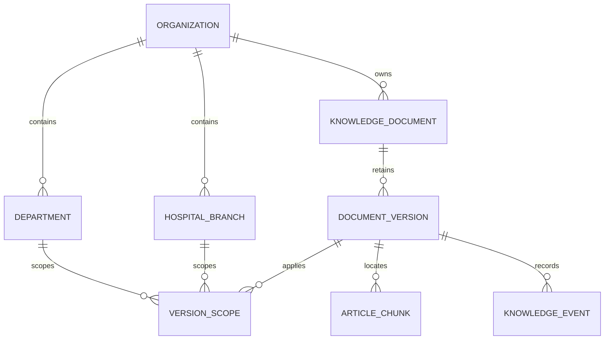
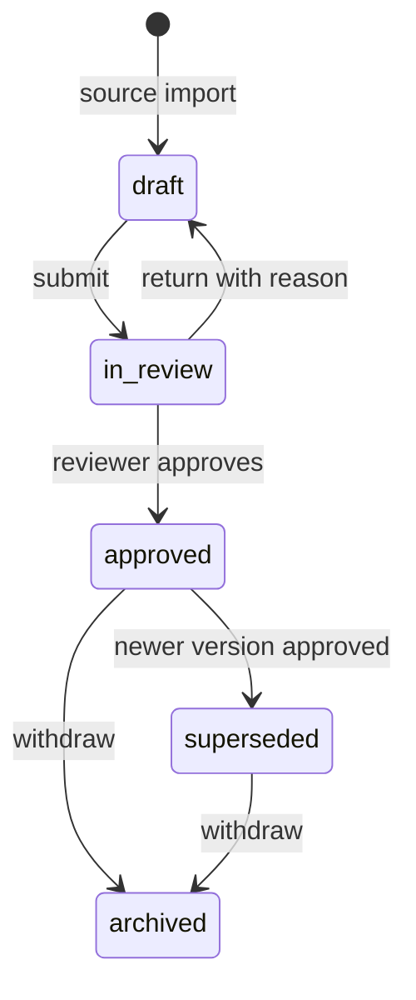

# Institutional source governance (#13–#15)

This layer manages authorized, nonpersonal education sources. It does not establish clinical safety,
diagnose patients or automatically approve model-generated content. The existing unscoped Demo remains
available to legacy accounts; institutional accounts use the governed API and `/knowledge` workspace.

## Data relationships



`articles.document_id` remains the stable document UUID; `document_versions.id` identifies an immutable
source revision. Each article has its own chunk UUID plus `document_version_id`. Rebuilding chunks must
keep that provenance; new source content always creates a new version instead of modifying approved
content. Source text, SHA256, license/use basis, URL, audience, effective period and branch/department
pairs belong to the version. Chunk metadata records source offsets, encoding strategy and source SHA.
The current institutional form accepts text. PDF attachment ingestion and full source viewer coverage
remain part of #16; the shared offline PDF manifest mapping is retained.

`001_knowledge_governance.sql` is an additive, idempotent migration run during initialization in every
account/organization schema. Old articles become stable `legacy-v1` Draft revisions with no scopes and
no assumed license. They are never automatically approved or eligible for official retrieval. Production
rollouts still require a backup; migration does not copy old principal namespaces into new organizations.

## Identity and authorization

API_USERS may specify `organization_id`, `branch_ids` and `department_ids`. Accounts with the same stable
organization ID share that organization's knowledge schema; legacy accounts retain their old per-principal
schema. Organization ID/role/grants come only from server configuration, never retrieval request fields.
Personal conversations are separately scoped to `owner_id` inside an organization; shared knowledge
does not grant access to another staff member's chat history. Changing an organization ID creates a new
namespace, so use stable IDs rather than display names.

Example configuration (replace every Token with a distinct generated secret of at least 32 ASCII chars):

```json
{
  "catalog-admin": {"token":"REPLACE_WITH_RANDOM_ADMIN_TOKEN_32PLUS", "role":"admin", "organization_id":"hospital-demo", "branch_ids":["north","south"], "department_ids":["general","lab"]},
  "source-author": {"token":"REPLACE_WITH_RANDOM_NURSE_TOKEN_32PLUS", "role":"nurse", "organization_id":"hospital-demo", "branch_ids":["north"], "department_ids":["general"]},
  "source-reviewer": {"token":"REPLACE_WITH_RANDOM_REVIEWER_TOKEN_32PLUS", "role":"reviewer", "organization_id":"hospital-demo", "branch_ids":["north"], "department_ids":["general"]},
  "source-reader": {"token":"REPLACE_WITH_RANDOM_READER_TOKEN_32PLUS", "role":"user", "organization_id":"hospital-demo", "branch_ids":["north"], "department_ids":["general"]}
}
```

Admin registers branch/department names only for configured grants. Nurse/Reviewer/Admin can create and
submit Draft versions. Reviewer/Admin can return, approve or withdraw. Reader accounts see only approved,
currently effective versions. Version ACLs additionally restrict roles and optionally named users.
Review actions require grants over **all** affected scopes, including the old approved version that would
be superseded. A reviewer authorized for North cannot publish a North+South revision.
Legacy `/api/documents` endpoints are blocked for organization accounts, preventing an older upload,
list, edit or delete route from bypassing governance. No API grants cross-organization access.

## Review and publication



Source content cannot be edited in place via this API. `POST /versions` with the stable document_id
creates v2, v3, etc.; version numbers are allocated under a document row lock. Approval atomically
supersedes the old approved revision and records both events. A partial unique index enforces at most
one approved version per document. All transitions require a nonblank reason and invalid transitions
return 409. Future-effective versions remain pending until their effective period starts; scheduled
publication is not implemented. An older revision cannot replace a later previously approved revision;
create a new revision for rollback content. Expired revisions cannot be newly approved.

Events include actor, source/target states, reason, version and timestamp. Database triggers reject
UPDATE/DELETE of event rows and there are no mutation endpoints for the event history. This is a basic
append-only application guard, not tamper-proof storage against a database administrator. Experiment
snapshots and release quality gates remain #19 work.

## API and workspace

All routes require an organization account's Bearer Token. Schemas are available in `/docs`.

| Method | Path | Purpose |
|---|---|---|
| GET | /api/knowledge/catalog | Current organization, role and authorized registered scopes |
| PUT | /api/knowledge/catalog/branches | Admin registers an allowed branch ID/name |
| PUT | /api/knowledge/catalog/departments | Admin registers an allowed department ID/name |
| POST | /api/knowledge/versions | Create a Draft source version and its chunks |
| GET | /api/knowledge/versions?document_id=UUID | Accessible version metadata/history |
| GET | /api/knowledge/versions/UUID | Accessible original source version |
| POST | /api/knowledge/versions/UUID/transition | submit / approve / return / withdraw, with reason |
| GET | /api/knowledge/documents/UUID/history | Authorized staff's append-only transition history |
| GET | /api/knowledge/chunks/UUID?branch_id=north&department_id=general | Revalidated current citation excerpt |
| GET | /api/knowledge/corpus-manifest?branch_id=north&department_id=general | Authorized current version/chunk manifest and checksum |

`POST /api/retrieval/search` and `POST /api/ask` require branch_id and department_id for organization
accounts. Their response records the actual applied filters. Raw mode skips distance heuristics but
**never** skips status, validity, organization, branch/department or ACL enforcement. The eligible set is
materialized in SQL before exact cosine ranking. This deliberately avoids filtered-ANN false negatives;
it trades performance for predictable scoped recall. HNSW remains the legacy baseline and future
scoped ANN optimizations must establish recall before replacing this path.

Official chat cannot disable RAG. If no approved evidence survives, it returns a fixed inability-to-confirm
response without calling the answer model. With evidence, a separate source-only prompt is used; the
legacy symptom/advice template is not appended, and no clinical risk classification is claimed. This
prompt restriction does not prove semantic faithfulness; #5/#18 evaluations and professional review
remain necessary. The source-revision approval workflow is separate from #17's future generated-draft
review/publication workflow.

Citation reads recheck current validity, state and grants. If a reference is withdrawn, superseded,
expired or no longer accessible, it is denied and old conversation answers using it are redacted from
API history responses. Underlying historical references remain stored for authorized future audit work.

In `/knowledge`, apply the appropriate Token, register allowed scope names as Admin, create a source
version as Nurse, submit it, switch to a Reviewer Token, inspect the original and approve with a reason.
Then query the selected scope and open its citation. Create a new revision to update content; withdraw
to stop future use. UI visibility is convenience only; every permission is enforced by the backend.

## Evaluation handoff

For institutional datasets, set `retrieval_context` to branch_id/department_id and `corpus_version` to
the manifest's manifest_sha256. The export CLI verifies that authorized manifest before and after the
run, replays expanded queries across modes and preserves the manifest in its report. It refuses changed
or mismatched corpora. The manifest contains hashes and stable IDs, not an independent review of source
correctness. Human-reviewed datasets, full #16 citation coverage, #17 generated drafts and #18/#19 gates
are not claimed complete by this source-governance change.

## PDF source provenance (#16)

`POST /api/knowledge/versions/pdf` accepts multipart `metadata` (the version JSON, omitting content)
and `file`. Only authorized staff may create a source; the server extracts the content itself with
pypdf. PDF bytes (up to 8 MiB) and their SHA256 are stored transactionally in `source_attachments`,
with an immutable one-to-one version binding. This bounded MVP uses PostgreSQL bytea rather than
requiring a separate public object store. Existing text versions remain unchanged.

Every original page retains a mapping/status: `extracted`, `no_text`, or `extraction_failed`.
Empty/failed pages are not assigned to chunks. An all-image/empty PDF is rejected; OCR is not
implemented. Damaged/encrypted PDFs fail clearly. Revision uploads create fresh version IDs and never
overwrite prior bytes. Chunk metadata includes original Unicode offsets and overlapping source pages.

The workspace accepts a PDF in the source editor, shows extraction diagnostics and opens original bytes
at the cited page. `GET /api/knowledge/versions/{version_id}/attachment` requires authorization; citation
reads also pass the chunk ID and scope and revalidate that exact version. Drafts/history remain staff-only;
expired/withdrawn/foreign sources are unavailable to readers. Responses disable caching, have fixed PDF
content type and never put credentials into URLs. Previously downloaded bytes cannot be revoked.

Tests run ten deterministic question→retrieval→citation→original-PDF paths across multiple pages, check
version/checksum/offset identity, retain blank-page diagnostics, reject invalid/encrypted files and exercise
withdrawal, foreign organization, scope and draft access. Embedding and generation are mocked in these
regression tests: they establish provenance and permissions, not semantic retrieval or clinical quality.
